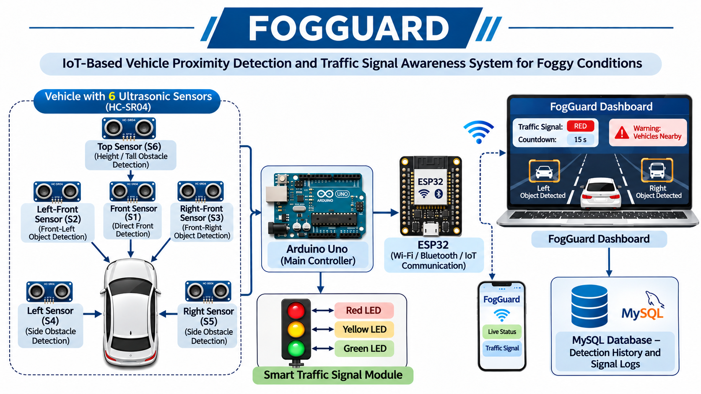

<div align="center">

# 🚘 FogGuard

### IoT-Based Vehicle Proximity Detection and Traffic Signal Awareness System for Foggy Conditions

A prototype designed to improve driver awareness in low-visibility conditions by detecting nearby obstacles, communicating traffic-signal status, and presenting alerts through a connected dashboard.



</div>

---

## 📌 Overview

**FogGuard** is an IoT-based vehicle proximity and traffic-signal awareness project. It combines ultrasonic sensing, embedded controllers, wireless communication, and a monitoring dashboard to help make nearby obstacles and traffic-signal information easier to notice—especially in foggy or low-visibility environments.

The system is intended as an **assistive prototype**, not a replacement for a driver's attention, conventional mirrors, road signs, or certified vehicle safety systems.

## ✨ Key Features

- **Multi-directional obstacle sensing:** Six HC-SR04 ultrasonic sensors are planned/represented for front, side, and overhead proximity detection.
- **Directional awareness:** Sensor positions distinguish left-front, front, right-front, left-side, right-side, and top/height-related obstacles.
- **Traffic-signal indication:** A red, yellow, and green LED module represents signal states in the prototype.
- **Wireless communication:** ESP32 provides Wi-Fi/Bluetooth connectivity for IoT communication.
- **Live dashboard concept:** A web dashboard displays traffic-signal status, nearby-object warnings, and directional detection indicators.
- **Mobile status view:** A mobile interface is represented for quick access to live status.
- **Detection history:** MySQL is intended to store detection history and traffic-signal logs.

## 🧩 System Architecture

The architecture illustrated below follows this flow:

1. **Sensors:** HC-SR04 ultrasonic sensors measure distance to nearby obstacles.
2. **Main controller:** Arduino Uno receives sensor readings and handles the sensing/control logic.
3. **Communication:** ESP32 provides wireless connectivity between the embedded system and the monitoring interface.
4. **Signal module:** Red, yellow, and green LEDs indicate the traffic-signal state in the prototype.
5. **Dashboard:** The FogGuard dashboard presents signal information, warnings, and directional object-detection status.
6. **Database:** MySQL is planned for storing detection history and signal logs.

### Sensor Layout

| Sensor | Position | Purpose |
|---|---|---|
| S1 | Front | Direct front obstacle detection |
| S2 | Left-front | Front-left obstacle detection |
| S3 | Right-front | Front-right obstacle detection |
| S4 | Left side | Side obstacle detection |
| S5 | Right side | Side obstacle detection |
| S6 | Top | Height / overhead obstacle detection |

> Sensor coverage and accuracy depend on mounting position, calibration, target material/shape, and environmental conditions.

## 🖼️ Project Architecture Diagram

The architecture image is included in this repository:


## 🛠️ Hardware Components

| Component | Role |
|---|---|
| Arduino Uno | Main sensing and control unit |
| ESP32 | Wi-Fi / Bluetooth / IoT communication |
| HC-SR04 ultrasonic sensors × 6 | Distance and obstacle sensing |
| Red, yellow, green LEDs / traffic-signal module | Signal-state indication |
| Jumper wires, breadboard, power supply | Prototyping and connections |
| Laptop / mobile device | Dashboard monitoring |

*The exact component count, wiring, and power arrangement should be confirmed against the final assembled prototype.*

## 💻 Software & Technologies

The project architecture includes the following technologies:

- **Embedded firmware:** Arduino-compatible development environment
- **Wireless/IoT:** ESP32 Wi-Fi and Bluetooth capabilities
- **Backend:** FastAPI (Python) — for the dashboard/API layer, where implemented
- **Real-time updates:** WebSocket communication, where implemented
- **Database:** MySQL — detection history and signal logs
- **Frontend:** FogGuard web dashboard and mobile-friendly status interface

> The list above describes the project architecture. Refer to the actual source code and configuration files for the exact versions, implemented modules, and setup commands.

## 🚀 Getting Started

### 1. Clone the repository

```bash
git clone <YOUR_REPOSITORY_URL>
cd FogGuard
```

### 2. Set up the software

Use the setup instructions and dependency files included in the repository. If the backend uses Python, a typical virtual-environment workflow is:

```bash
python -m venv .venv
```

Activate it:

**Windows**
```bash
.venv\Scripts\activate
```

**Linux / macOS**
```bash
source .venv/bin/activate
```

Install dependencies using the project's dependency file (for example, `requirements.txt` if present):

```bash
pip install -r requirements.txt
```

### 3. Configure the database

- Install and start MySQL if the application requires it.
- Create the database and user according to the project's configuration.
- Set database credentials using the environment/configuration mechanism documented in the source code.
- Never commit passwords, API keys, or other secrets to GitHub.

### 4. Upload the firmware

- Open the Arduino firmware in the Arduino IDE.
- Select the correct board and port.
- Verify sensor wiring and pin definitions in the firmware.
- Upload the firmware to the Arduino Uno.
- Configure and upload ESP32 firmware separately if the repository contains it.

### 5. Run the application

Start the backend and frontend using the commands documented in their respective folders or project scripts. Open the dashboard in a browser and verify that the configured devices are communicating.

> **Note:** Exact commands, environment variables, and firmware paths depend on the files in the repository. Add the tested commands here before publishing a reproducible release.

## 🔌 High-Level Data Flow

```text
HC-SR04 Sensors (S1–S6)
          │
          ▼
     Arduino Uno
  (sensing & control)
          │
          ▼
        ESP32
 (wireless communication)
          │
          ▼
   FogGuard Dashboard
   ├── Signal status
   ├── Directional alerts
   └── Live monitoring
          │
          ▼
      MySQL Database
 (detections & signal logs)
```

## ⚠️ Safety & Limitations

- FogGuard is an academic/prototyping project and is **not a certified automotive safety system**.
- Ultrasonic sensors have limited range and may be affected by target angle, surface, weather, mounting, and interference.
- The prototype's traffic-signal indication should not be assumed to detect or interpret real-world traffic lights unless a separate validated signal-detection mechanism is implemented.
- Do not use the prototype as the sole basis for driving, braking, or road-crossing decisions.
- Test in a controlled, safe environment—not on public roads.

## 🔭 Future Scope

- Improve sensor calibration and filtering for more stable distance readings.
- Add a validated camera/computer-vision module for real traffic-signal recognition.
- Improve directional alert prioritization and warning thresholds.
- Add configurable alert levels and richer detection analytics.
- Improve mobile responsiveness and dashboard accessibility.
- Evaluate performance under controlled low-visibility test conditions.

## 👥 Team

**Department of Computer Science and Engineering**  
**National Institute of Technology Delhi**

| Name | Roll Number |
|---|---|
| Somya Garg | 251210118 |
| Shivam Rattan | 251210109 |
| Satyam Jha | 251210105 |
| Vishwanath V | 251210138 |

**Submitted to:** Dr. Arjun

## 📄 License

Add a `LICENSE` file before publishing if you want others to reuse, modify, or distribute this project. Choose a license that matches your team's intentions and institutional requirements.

---

<div align="center">

**FogGuard — Making proximity and signal awareness clearer in low visibility.**

</div>
